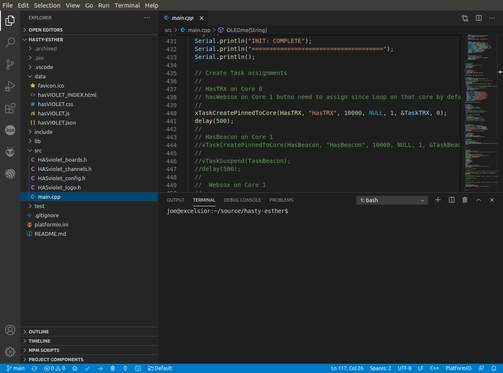
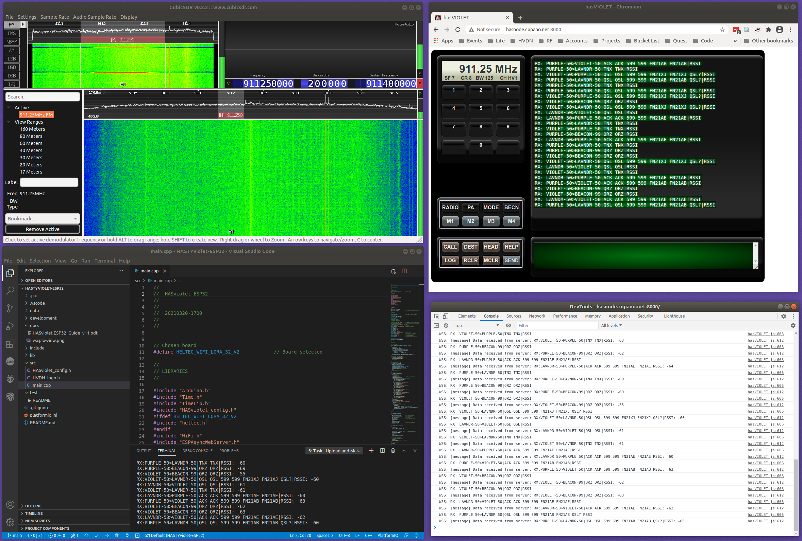

# HASviolet ESP32

HASviolet ESP32 is a (very much) work-in-progress LoRa transceiver node that is part of the HASviolet project. Best efforts are made to document as much of the build and code as possible in unvarnished language.

## Table of Contents

- [Quick Start](#Quick-Start)

- [Build It](#Build-It)

- [Watch It](#Watch-It)

- [Hack It](#Hack-It)

# Quick Start

The quickest way to get started with HASviolet ESP32 is to

- Buy a supported board: Heltec WiFi LoRa 32 V2 (also sold as HiLetgo ESP32 LoRa V2) or Heltec WiFi LoRa 32 V3
- Download the [latest release](https://github.com/joecupano/hasty-esther/releases)
- Upload the BIN file to the device using your favorite ESP32 Flash tool

| Board | MCU | Radio | PlatformIO environment |
|---|---|---|---|
| Heltec WiFi LoRa 32 V2 | ESP32 | SX1276 | `heltec_wifi_lora_32_V2` (default) |
| Heltec WiFi LoRa 32 V3 | ESP32-S3 | SX1262 | `heltec_wifi_lora_32_V3` |

Alternatively, you can compile the firmware yourself by cloning this repo and following the instructions in the "Build It" section.

# Build It

All coding was performed using [Visual Studio Code](https://code.visualstudio.com/) with the [PlatformIO for VS Code extension](https://marketplace.visualstudio.com/items?itemName=platformio.platformio-ide). Follow the installation instructions for those components. Linux is my platform of choice for development. 

## Create your Workspace

I keep a home directory for all my source code so I suggest creating your own before cloning the HASviolet ESP32 repo.

```
mkdir ~/source
git clone https://github.com/joecupano/hasty-esther.git
```

Once cloned, go ahead and start Visual Studio Code and open the folder of where the cloned repo is in. You should get a screen similar to below.



Library and platform versions in `platformio.ini` are pinned; do not float them, as newer releases have broken earlier builds. The upload port is auto-detected. If it is not, set `upload_port` and `monitor_port` for your machine (typically `/dev/ttyUSB0` for V2 and `/dev/ttyACM0` for V3).

User options (Wi-Fi, ports, default radio settings) are in `src/HASviolet_config.h`. Board pins are in `src/HASviolet_boards.h`. The board itself is chosen by the PlatformIO environment, not by editing a header.

On Linux you may need serial access: `sudo usermod -aG dialout $USER`, then log out and back in.

## Build firmware

To test that the firmware is compiling correctly without flashing it to a device either use the terming that is part of VSC or open a terminal and navidate to the clones repo folder and run the following

```
pio run
```

This will compile all libraries and main firmware files. The resulting binary is stored as `.pio/build/<environment>/firmware.bin`

## Flash firmware

Connect your computer to the board using a usb cable,

In `platformio.ini` make sure `upload_port`, `upload_speed`, etc are correct for your device. First, you flash the file system as follows:

```
pio run -t uploadfs
```

followed by flashing the code:

```
pio run -t upload
```

By default, PlatformIO builds and flashes firmware for the Heltec V2. To build for the V3, select its environment. For example, to flash the firmware and file system for the V3:

```
pio run -e heltec_wifi_lora_32_V3 -t uploadfs
pio run -e heltec_wifi_lora_32_V3 -t upload
```

Wi-Fi: to join an existing network, uncomment `HASV_WIFI_SSID` and `HASV_WIFI_KEY` in `src/HASviolet_config.h` (do not commit real credentials). If the connection fails after about 10 seconds the node starts its own access point (`HASviolet`, password `purple99`; the password must be at least 8 characters). The IP address is printed on the serial console.

## Creating Binary for Release

A full binary image can be created by reading the flash contents of a ESP32 that is flashed with the latest release of the firmware. To do this, run the following command,

```
esptool.py -p /dev/ttyUSB0 -b 921600 read_flash 0 0x400000 esp_flash.bin
```

This can then be flashed to a new device like so,

```
esptool.py -p /dev/ttyUSB0 --baud 460800 write_flash 0x00000 esp_flash.bin
```

# Watch It

Once the firmware and SPIFFS image has been successfully flashed, connect to the USB serial in monitor mode  

```
pio device monitor
```

After that, press the RST button on the ESP32 and you should see the following boot sequeunce;

```
INIT: HASviolet ESP32 (Heltec V2)
=====================================
 600: OLED Initialized
 100: SPIFFs initialized
 200: JSON loaded
 250: LoRa initialized
 300: WiFi AP, IP 192.168.4.1
 400: Webserver initialized
 500: Websockets initialized
INIT: COMPLETE
=====================================
```

# Hack It

## Architecture Model

HASviolet ESP32 is made up of three parts;  radio (LoRa transceiver), server, and client.

- Server
  
  - an ESP32 device that runs Web/Websockets services for communications with the client on Core 1 and LoRa communications on Core 0
  - LoRa libraries/functions interact with the radio via the [SPI interface](http://iot-bits.com/esp32/esp32-spi-tutorial-part-1/)

- Radio
  
  - an RF hardware module (such as the [sx1276](https://www.semtech.com/products/wireless-rf/lora-transceivers/sx1276)) capable of LoRa that is either embedded or external to the ESP32 device and connected via SPI

- Client
  
  - Web browser that runs the HASviolet ESP32 Web UI interface
  - Browser connects to Web service on ESP32 device and loads an [HTML file](https://github.com/joecupano/hasty-esther/blob/main/data/hasVIOLET_INDEX.html) loaded with HTML5, CSS, and Javascript
  - On load, Javascript runs and connects to the Websocket service on the ESP32 device to establish a websocket session
  - Received data, data to be transmitted, and radio commandsare commuicated over the websocket session

## Workflow Model

### Server

This is the sequence of initialization (<mark>INIT</mark>) events that occurs doing server (ESP32) device startup from within the <mark>void setup()</mark> loop;

- **000** Serial port starts and the board is initialized (Vext power and OLED reset)

- **600** If an OLED is present it is initialized and shows the HVDN logo from <mark>HVDN_logo.h</mark>

- **100** SPIFF system initializes

- **200** Loading of the <mark>hasVIOLET.json</mark> file from the SPIFFs image. The server is updated with the JSON configuration

- **300** WiFi service starts first looking for an existing known network and if none (after about 10 seconds) then starts its own AP. The WiFi service will first try to connect to any <mark>WIFI_SSID</mark> and <mark>WIFI_KEY</mark> that was specified in <mark>HASviolet_config.h</mark> at compile time. If it cannot connect to an existgin WiFi specified, it will create a WiFI Access Point with the <mark>WIFI_APSSID</mark> and <mark>WIFI_APKEY</mark> specified in <mark>HASviolet_config.h</mark> at compile time.

- **400** Webserver service is started with callbacks for each of the HTML, CSS. JS, JSON files. A favorico.ico is included in the SPIFFs image for browsers that (annoyingly) look for such image objects

- **500** Websocket service is started with callback for processing websocket messages

- **250** The LoRa radio starts using the settings from the JSON file. If no radio is found the node reports the error and halts.

- INIT is complete and the radio task is started on core 0

#### *FreeRTOS Magic*

For many LoRa projects out there, the use case has the ESP32 as either a receiver or a transmitter but rarely both. If the use case does do both you will see alot deep dive into C/C++ in the coding yet still run into an issue with the hardware largely due to QA of the board manaufacturers. This is all because you never want LoRa receive process to miss a packet unless it is transmitting. But we also need WebSockets always running not missing a message. This led us down the path of experimenting pinning process to cores which involved touchin into the world of [FreeRTOS](https://www.freertos.org/) on the ESP32.

The ESP32 has two cores. The rule is that only one core touches each resource:

- <mark>HasTRX</mark>, a task pinned to Core 0, is the only code that touches the radio (and OLED). It loops forever, sending anything queued for transmit and checking for received packets.
- <mark>loop()</mark> on Core 1 is the only code that touches the WebSocket server.
- The two exchange messages through two FreeRTOS queues: <mark>txQueue</mark> (browser to radio: messages, TX power, tuner changes) and <mark>rxQueue</mark> (radio to browser: received packets).

Earlier versions transmitted from one core and received on the other, which corrupted radio state. Keeping all radio access in one task fixed that. A tuner change from the client re-initializes the radio inside <mark>HasTRX</mark>.

Admittedly this is less than perfect but reflects our evolving education and persistence for a more perfect union of a true LoRa transciver with WebSockets.

### Radio

Our focus has been on ESP32 boards with embedded LoRa modules either from [HopeRF]([LoRa module - HOPE MicroElectronics](https://www.hoperf.com/modules/lora/index.html)) or [Semtech](https://www.semtech.com/lora/lora-products) connected via SPI. Board differences are isolated in <mark>src/HASviolet_radio.h</mark>:

- Heltec V2 (SX1276) uses the [sandeepmistry/LoRa](https://github.com/sandeepmistry/arduino-LoRa) library.
- Heltec V3 (SX1262) uses [RadioLib](https://github.com/jgromes/RadioLib).

Both use the private LoRa sync word, CRC on, and PA_BOOST on the V2. TX power is limited to what each radio supports (V2: 2-20 dBm, V3: -9 to 22 dBm). Outgoing messages are limited to 254 bytes.

### Client

When the web browser connects to the server, it loads four files in the following order;

- **hasVIOLET_INDEX.html** Besides the skeleteon look of UI, it tells the browser to load  up the CSS and JS files in that order

- **hasVIOLET.css** Makes the UI look pretty and add texture to actions on screen

- **hasVIOLET.js **Javascript code that does all the "heavy lifting." It communicates all actions as WebSocket messages to the server that include changing channels, radio settings, as well as messages to be transmitted and those received Code also includes UI usabailityt such as defining macros and UI housekeeping. The code is well documented and includes numerous logs viewable from the browsers inspect window in the consoles tab.

- **hasVIOLET.json** a client configuration (JSON) file loaded into from the server that includes radio, contact, macor, and channel settings. These settings are stoed in variabels and can be changed through various commands includ CMDline in the transmit window.

- **favicon.ico** A small graphic icon file to shut up browsers that look always look for icons when connecting to a server. 

During development it is common for me to run VSC with a monitor window set to view serial output, a web browser connected to the ESP32 with an inspect window open looking at the console tab, and a RTL-SDR running looking at LoRa packets fly by. All necessary since changing functionality may be an asychronous process of JS, EPS32, and HTML code updates.



## Building and uploading SPIFFS image

Building and uploading a SPIFFS image is only necessary if you change any files in the <mark>data folder</mark>. This would occur if you are making changes to the Web UI itself. When you do make a change, build and upload the new SPIFFS image as follows:

```
pio run -t uploadfs
```

## Avoiding Library Hell

Some useful hints for developing this firmware using platformio are included here,

- It may be a good idea to delete the libdeps folder prior to rebuilding, as old, out-dated libraries could case conflits. To do this, `rm -rf .pio/libdeps`.
- Keep every dependency listed with an exact version in `platformio.ini`. Do not mix V2 and V3 library assumptions: current Heltec libraries target V3 only.
- If you would like to make changes to a specific library you can clone the library into the `firmware/lib` folder that is created after running `pio run` and then comment it out or remove it from the `lib_deps` list in the `platformio.ini` file.
- If you're including new libraries in the firmware, for PlatformIO, you wil need to add them to `platformio.ini` under `lib_deps`.
